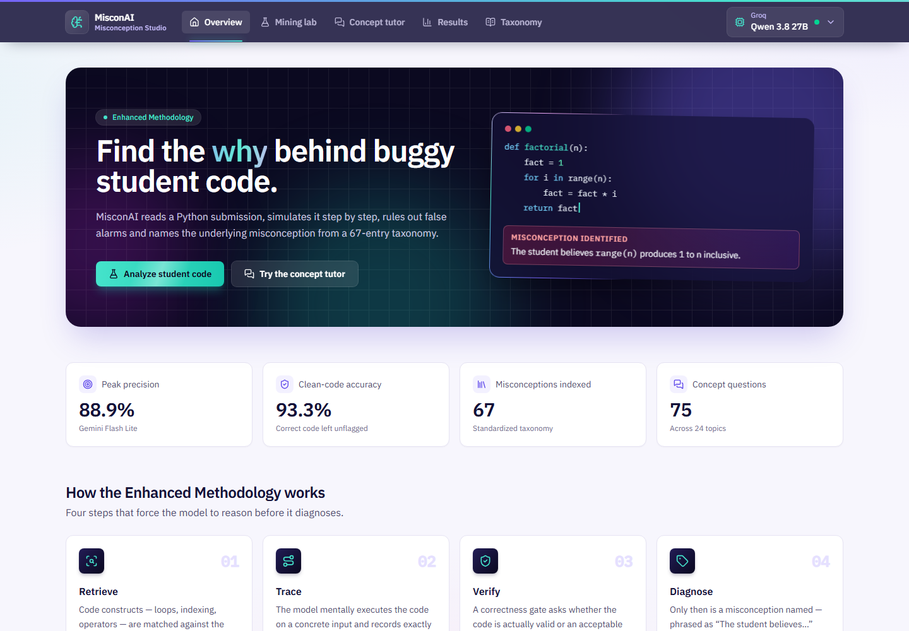
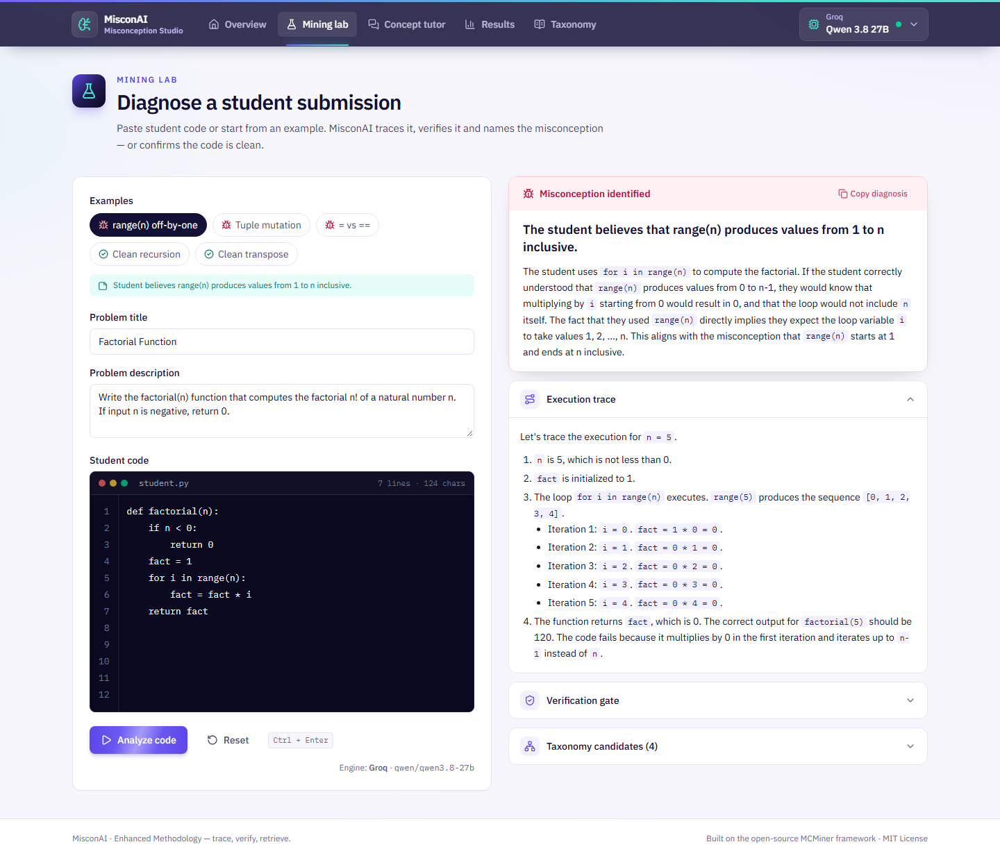
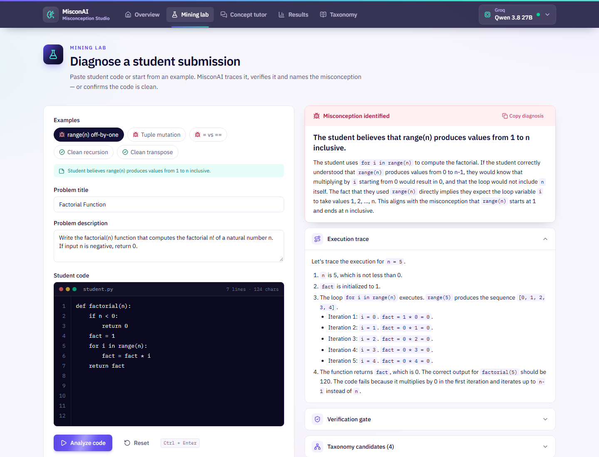
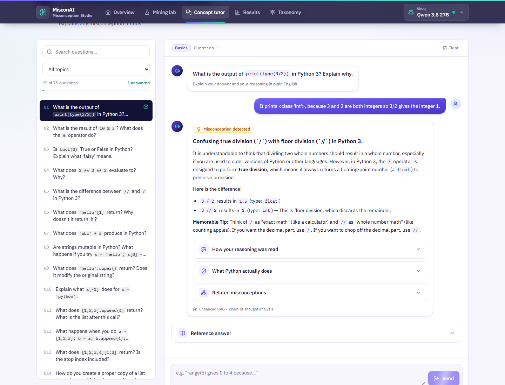
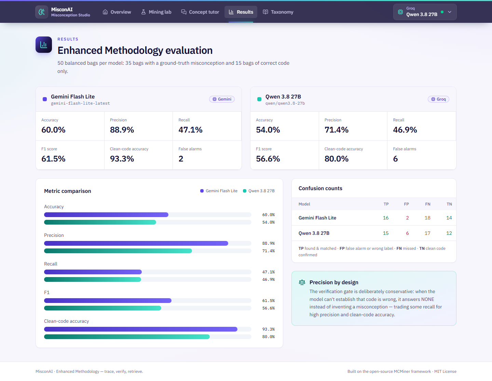
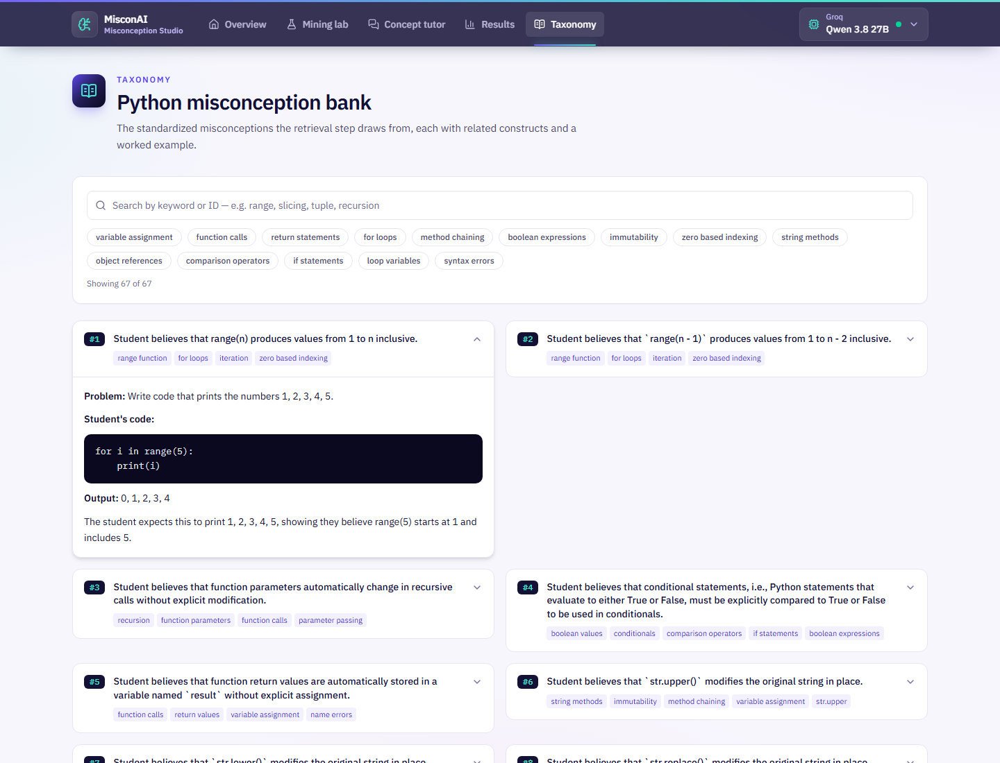
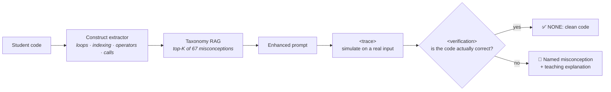
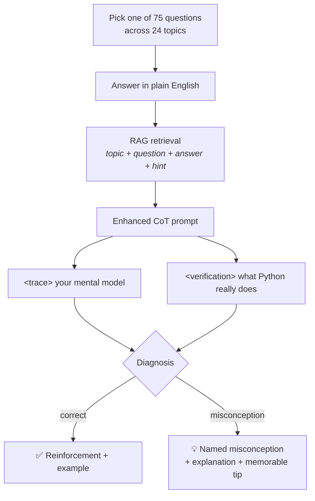
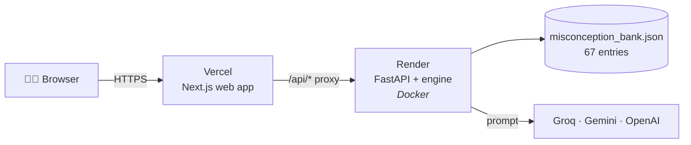

<div align="center">

# 🧠 MisconAI

### Find the *why* behind buggy student code

MisconAI reads a student's Python submission, simulates it step by step, rules out false alarms,<br/>
and names the underlying **misconception** from a 67-entry taxonomy, with a friendly explanation.

<br/>

[](https://misconception-ai-six.vercel.app/lab)


**Engines:** Groq · Google Gemini · OpenAI &nbsp;|&nbsp; **Taxonomy:** 67 misconceptions &nbsp;|&nbsp; **Problems:** 501 &nbsp;|&nbsp; **Tutor questions:** 75

<br/>



</div>

---

## 🚀 Live demo

| Page | Link |
| :--- | :--- |
| 🏠 Overview | **https://misconception-ai-six.vercel.app/** |
| 🧪 Mining lab (start here) | **https://misconception-ai-six.vercel.app/lab** |
| 💬 Concept tutor | https://misconception-ai-six.vercel.app/tutor |
| 📊 Results | https://misconception-ai-six.vercel.app/results |
| 📚 Taxonomy | https://misconception-ai-six.vercel.app/taxonomy |

> [!NOTE]
> The API runs on Render's free plan and goes to sleep after about 15 minutes without visitors.
> If the first page says **"Can't reach the MisconAI API"**, wait 30–60 seconds while it wakes up, then click **Retry**.

---

## 📑 Table of contents

1. [Try it in 60 seconds](#-try-it-in-60-seconds)
2. [Screenshots](#-screenshots)
3. [What is a programming misconception?](#-what-is-a-programming-misconception)
4. [How it works: the Enhanced Methodology](#%EF%B8%8F-how-it-works-the-enhanced-methodology)
5. [Evaluation](#-evaluation)
6. [Concept tutor](#-concept-tutor)
7. [Architecture & tech stack](#%EF%B8%8F-architecture--tech-stack)
8. [Datasets](#-datasets)
9. [Project structure](#-project-structure)
10. [Run it locally](#-run-it-locally)
11. [Run it with Docker](#-run-it-with-docker)
12. [Deploy your own copy](#%EF%B8%8F-deploy-your-own-copy)
13. [Troubleshooting](#-troubleshooting)
14. [Acknowledgments & license](#-acknowledgments--license)

---

## ⏱ Try it in 60 seconds

1. Open the **[Mining lab](https://misconception-ai-six.vercel.app/lab)**.
2. The first example, **range(n) off-by-one**, is already loaded. It's a factorial function that multiplies by `0` because it loops over `range(n)`.
3. Press **Analyze code** (or **Ctrl + Enter**). You'll watch four steps run: *retrieve → trace → verify → diagnose*.
4. Read the diagnosis, then expand **Execution trace** to see the program simulated line by line.
5. Try **Clean recursion**, a correct solution. MisconAI should confirm the code is clean instead of inventing a problem.
6. Head to the **[Concept tutor](https://misconception-ai-six.vercel.app/tutor)**, pick a question and answer in your own words.

Use the picker in the top-right corner to switch between models (Groq · Gemini · OpenAI). A 🟢 green dot means that provider is ready.

---

## 📸 Screenshots

### Mining lab: diagnosing a student submission
The model traces `factorial(5)` iteration by iteration, sees `fact` stuck at `0`, and names the misconception.



<details>
<summary><b>While it's analyzing</b> (click to expand)</summary>
<br/>

</details>

### Concept tutor: checking a mental model in plain English
The student says `type(3/2)` is `int`. The tutor names the misconception (true division vs. floor division) and explains it with an example and a memorable tip.



### Results: evaluation dashboard


### Taxonomy: the 67-entry misconception bank


---

## 🤔 What is a programming misconception?

When students learn Python, their errors are rarely random typos. They usually come from **false mental models** of how the language works. Unit tests and linters only tell you *that* code failed; MisconAI explains *why*.

A **programming misconception** is:
* a systematic, false belief about language semantics, built-in functions or data structures;
* **concrete and reproducible** across different problems;
* **distinct from typos, syntax slips or a misread prompt**.

| Misconception | What the student writes | What they believe |
| :--- | :--- | :--- |
| Range boundary | `for i in range(n):` to count 1…n | `range(n)` yields `1 … n` instead of `0 … n-1` |
| Tuple immutability | `test_tup.append(val)` | Tuples can be changed in place |
| Assignment vs. equality | `if x = 0:` | `=` compares values |
| Boolean distribution | `if x == a or b:` | It means `x == a or x == b` |

---

## ⚙️ How it works: the Enhanced Methodology

MisconAI forces the model to **reason before it diagnoses**, using three mechanisms:



1. **Mental execution tracing (`<trace>`)**: the model simulates the program on a concrete input *before* drawing any conclusion, so the diagnosis is based on what the code really does.
2. **Correctness verification (`<verification>`)**: an explicit check asks whether the code is valid or an acceptable alternative. If it is, the answer is forced to `NONE`. **This is what keeps false alarms low.**
3. **In-context taxonomy RAG ([utils/misconception_rag.py](utils/misconception_rag.py))**: the code's constructs are matched against the misconception bank, and the most relevant definitions are put into the prompt so diagnoses use standard wording.

The model replies in structured XML that the app parses into the views you see:

```xml
<reasoning>
  <trace>…</trace>
  <verification>…</verification>
</reasoning>
<misconception>
  <description>The student believes …</description>
  <explanation>…</explanation>
</misconception>
```

📄 Full prompt: [src/prompt_templates/mining/enhanced-cot-mining.md](src/prompt_templates/mining/enhanced-cot-mining.md)

---

## 📊 Evaluation

### Setup
* **50 balanced bags per model**: 35 contain a ground-truth misconception and 15 contain only correct code.
* A prediction counts as a **true positive (TP)** only if the predicted misconception **matches the ground truth**. Flagging the wrong misconception counts as a **false positive (FP)**.
* Each model was run twice: once with the **Baseline** prompt and once with the **Enhanced Methodology** (trace + verification + RAG).

| Metric | Meaning |
| :--- | :--- |
| **Precision** | Of the misconceptions MisconAI reported, how many were right |
| **Recall** | Of the real misconceptions, how many MisconAI found |
| **Clean-code accuracy** | Of the correct submissions, how many were correctly left unflagged |
| **False alarms (FP)** | Wrong or invented diagnoses: the thing that hurts students most |

### Enhanced Methodology: headline results

| Model | Accuracy | Precision | Recall | F1 | Clean-code accuracy | False alarms |
| :--- | :---: | :---: | :---: | :---: | :---: | :---: |
| **Google Gemini** (`gemini-flash-lite-latest`) | **60.0%** | **88.9%** | 47.1% | **61.5%** | **93.3%** (14/15) | **2** |
| **Groq** (`qwen/qwen3.8-27b`) | 54.0% | 71.4% | 46.9% | 56.6% | 80.0% (12/15) | 6 |

| Model | TP | FP | FN | TN |
| :--- | :---: | :---: | :---: | :---: |
| Gemini Flash Lite | 16 | 2 | 18 | 14 |
| Qwen 3.8 27B | 15 | 6 | 17 | 12 |

### Baseline vs. Enhanced: what the method changes

**Google Gemini (`gemini-flash-lite-latest`)**

| Metric | Baseline | Enhanced | Change |
| :--- | :---: | :---: | :---: |
| Accuracy | 46.0% | **60.0%** | 🟢 +14.0 pts |
| Precision | 61.5% | **88.9%** | 🟢 +27.4 pts |
| Recall | **48.5%** | 47.1% | ⚪ −1.4 pts |
| F1 score | 54.2% | **61.5%** | 🟢 +7.3 pts |
| Clean-code accuracy | 46.7% (7/15) | **93.3%** (14/15) | 🟢 +46.7 pts |
| False alarms | 10 | **2** | 🟢 −80% |

**Groq (`qwen/qwen3.8-27b`)**

| Metric | Baseline | Enhanced | Change |
| :--- | :---: | :---: | :---: |
| Accuracy | 46.0% | **54.0%** | 🟢 +8.0 pts |
| Precision | 51.2% | **71.4%** | 🟢 +20.3 pts |
| Recall | **78.6%** | 46.9% | 🔴 −31.7 pts |
| F1 score | **62.0%** | 56.6% | 🔴 −5.4 pts |
| Clean-code accuracy | 6.7% (1/15) | **80.0%** (12/15) | 🟢 +73.3 pts |
| False alarms | 21 | **6** | 🟢 −71% |
| Run time (50 bags) | 75.6 min | **15.2 min** | 🟢 ~5× faster |

### Reading the numbers

* ✅ **False alarms drop sharply on both models** (10 → 2 and 21 → 6). The baseline Qwen run flagged a "misconception" in **14 of 15 correct programs**; with the verification check it leaves 12 of 15 alone.
* ✅ **Precision rises by 20–27 points.** When MisconAI does report a misconception, it is right far more often.
* ⚖️ **The trade-off is recall.** The check is deliberately conservative: when the model cannot show that the code is wrong, it answers `NONE`. For Gemini this costs almost nothing (−1.4 pts). For Qwen it costs a lot, because the baseline found many real misconceptions mainly by flagging *almost everything*, which is why its baseline F1 looks higher.
* 🎓 **Why precision matters here:** telling a student their *correct* code reflects a misconception damages trust and teaches the wrong thing. MisconAI is tuned to be right when it speaks.

📁 Raw results: [dataset/bags_and_results/gemini_evaluations/](dataset/bags_and_results/gemini_evaluations/) · [dataset/bags_and_results/enhanced_evaluations/](dataset/bags_and_results/enhanced_evaluations/)

---

## 💬 Concept tutor

The tutor applies the same Enhanced Methodology to **free-text answers** instead of code.



* **Free text, not multiple choice**: you have to explain your thinking, and the model judges reasoning, not keywords.
* **No scoring**: it's a learning tool, not a test. A progress bar tracks how many questions you've tried.
* **Retry freely**: each question keeps its own conversation, and the reference answer is one click away.
* **Topics:** Basics, Strings, Lists, Tuples, Sets, Dicts, Control Flow, Functions, OOP, Exceptions, Comprehensions, File I/O, Modules, Generators, Decorators, Types, Built-ins, Memory, Scope, Recursion, Operators, Iterators, Python 3 and Advanced.

---

## 🏗️ Architecture & tech stack



| Layer | Technology | Where |
| :--- | :--- | :--- |
| Frontend | Next.js 16 (App Router), React 19, Tailwind CSS 4, lucide icons | [web/](web/) |
| API | FastAPI + Uvicorn | [src/server.py](src/server.py) |
| Analysis engine | Prompt building, LLM calls, XML parsing | [src/core/engine.py](src/core/engine.py) |
| Retrieval | Construct-based taxonomy RAG | [utils/misconception_rag.py](utils/misconception_rag.py) |
| LLM clients | Groq (OpenAI-compatible), Gemini (GenAI SDK, thinking budget), OpenAI (o-series reasoning effort) | [utils/llm_clients.py](utils/llm_clients.py) |
| Hosting | Vercel (web) + Render (API, Docker) | [render.yaml](render.yaml) |

**Design:** a "Midnight Aurora" palette (deep indigo, electric violet and an aqua accent) set in IBM Plex Sans and Plex Mono. Subtle motion (count-up stats, scroll reveals, a live analysis stepper) switches off automatically for users who prefer reduced motion.

---

## 📦 Datasets

Everything lives in [`dataset/`](dataset/):

| File / folder | Contents |
| :--- | :--- |
| `problems_processed.json` | **501** programming tasks (MBPP, Socratic Debugging, Auckland logic errors, FalconCode, handcrafted educator tasks), avg. 3.31 unit tests each |
| `misconception_bank.json` | **67** standardized misconceptions (Python Programming Misconception Bank, SIDELib, education research), each with related constructs and a worked example |
| `corrupted_codes_best/` | **1,063** code samples with ground-truth misconception labels |
| `bags_and_results/` | Multi-instance problem bags and stored evaluation runs |

---

## 🗂 Project structure

```text
Misconception-AI/
├── dataset/
│   ├── bags_and_results/              # Problem bags & evaluation outputs
│   ├── corrupted_codes_best/          # Ground-truth code samples
│   ├── misconception_bank.json        # 67 misconceptions
│   └── problems_processed.json        # 501 problems with unit tests
├── src/
│   ├── server.py                      # FastAPI service used by the web app
│   ├── core/
│   │   ├── engine.py                  # Enhanced pipeline: prompt, LLM call, parsing
│   │   ├── questions.py               # 75-question concept bank
│   │   ├── presets.py                 # Mining-lab examples
│   │   └── results.py                 # Loads stored evaluation metrics
│   └── prompt_templates/mining/
│       └── enhanced-cot-mining.md     # Trace + verification + RAG prompt
├── utils/
│   ├── llm_clients.py                 # Groq, Gemini and OpenAI connectors
│   └── misconception_rag.py           # Construct-based taxonomy RAG
├── web/                               # Next.js frontend
│   ├── src/app/                       # /, /lab, /tutor, /results, /taxonomy
│   ├── src/components/                # Header, engine picker, diagnosis view, UI kit
│   ├── src/lib/                       # Typed API client
│   └── Dockerfile
├── img/screenshots/                   # README screenshots
├── Dockerfile                         # API image
├── docker-compose.yml                 # API + web together
├── render.yaml                        # Render deployment blueprint
├── requirements.txt
└── LICENSE
```

---

## 💻 Run it locally

**You need:** Python 3.10–3.13, Node.js 20.9+, and at least one API key ([Groq](https://console.groq.com/keys) and [Gemini](https://aistudio.google.com/apikey) both have free tiers).

**1. Clone and install**

```bash
git clone https://github.com/nikhilkumar905/Misconception-AI.git
cd Misconception-AI

python -m venv venv
venv\Scripts\activate            # Windows
# source venv/bin/activate       # macOS / Linux

pip install -r requirements.txt
cd web && npm install && cd ..
```

**2. Add your API keys:** create a `.env` file in the project root (copy `.env.example`):

```env
GROQ_API_KEY=your_groq_key
GEMINI_API_KEY=your_gemini_key
OPENAI_API_KEY=your_openai_key    # optional
```

You only need the key for the provider you use. The model picker shows 🟢 when a key is found.

**3. Start both parts** in two terminals:

```bash
# Terminal 1: API (project root, venv active)
python src/server.py              # → http://127.0.0.1:8000

# Terminal 2: web app
cd web
npm run dev                       # → http://localhost:3000
```

Open **http://localhost:3000**. The web app forwards `/api/*` to the Python service. Set `MISCONAI_API_URL` to point it somewhere else.

---

## 🐳 Run it with Docker

With [Docker Desktop](https://www.docker.com/products/docker-desktop/) running and your `.env` in place:

```bash
docker compose up -d --build
```

| Service | URL |
| :--- | :--- |
| Web app | http://localhost:3000 |
| API health check | http://localhost:8000/api/health |

In Docker Desktop you'll see a **misconai** group with `api-1` and `web-1`. Useful commands:

```bash
docker compose logs -f            # follow logs
docker compose down               # stop and remove
docker compose up -d --build      # rebuild after code changes
```

Your `.env` is passed in when the containers start, not stored in the image. Edit it and restart `api-1` to change keys.

---

## ☁️ Deploy your own copy

The API goes on **Render** and the web app on **Vercel**. Deploy Render first, because Vercel needs its address.

**1. API on Render**
1. Fork this repo, then open `https://render.com/deploy?repo=<your-fork-url>`.
2. Render reads [render.yaml](render.yaml). Fill in `GROQ_API_KEY` / `GEMINI_API_KEY` (and `OPENAI_API_KEY` if you have one) → **Apply**.
3. When it shows **Live**, copy the address (e.g. `https://misconai-api.onrender.com`) and check `…/api/health` returns `{"ok":true}`.

**2. Web app on Vercel**
1. **Add New → Project** → import your fork.
2. Set **Root Directory** to **`web`**. This is the step most often missed.
3. Add the environment variable `MISCONAI_API_URL` = your Render address (no trailing `/`).
4. **Deploy.**

After that, every `git push` to `main` redeploys both. If you change `MISCONAI_API_URL`, **redeploy** on Vercel, because the address is fixed when the site is built.

---

## 🛠 Troubleshooting

| Problem | Fix |
| :--- | :--- |
| "Can't reach the MisconAI API" on the live site | The free Render API is waking up. Wait 30–60 s and click **Retry** |
| "Can't reach the MisconAI API" locally | Start the API: `python src/server.py` |
| Model picker shows an amber dot / "key not set" | Add that provider's key to `.env` (or Render → Environment) and restart the API |
| "The model answered, but not in the expected format" | Retry, or switch to a different model in the picker |
| Docker: `port 3000 is not available` | Something else is using port 3000 (often `npm run dev`). Close it, or change `"3000:3000"` to `"3001:3000"` in `docker-compose.yml` |
| Vercel build: "No Next.js version detected" | Set **Root Directory** to `web` and redeploy |

---

## 🙏 Acknowledgments & license

MisconAI builds on the open-source **MCMiner** research framework for automated misconception mining (MIT License), and on the public datasets and misconception collections listed under [Datasets](#-datasets).

Released under the **MIT License**. See [LICENSE](LICENSE).

<div align="center">
<br/>
<b><a href="https://misconception-ai-six.vercel.app/lab">▶ Try MisconAI live</a></b>
</div>
