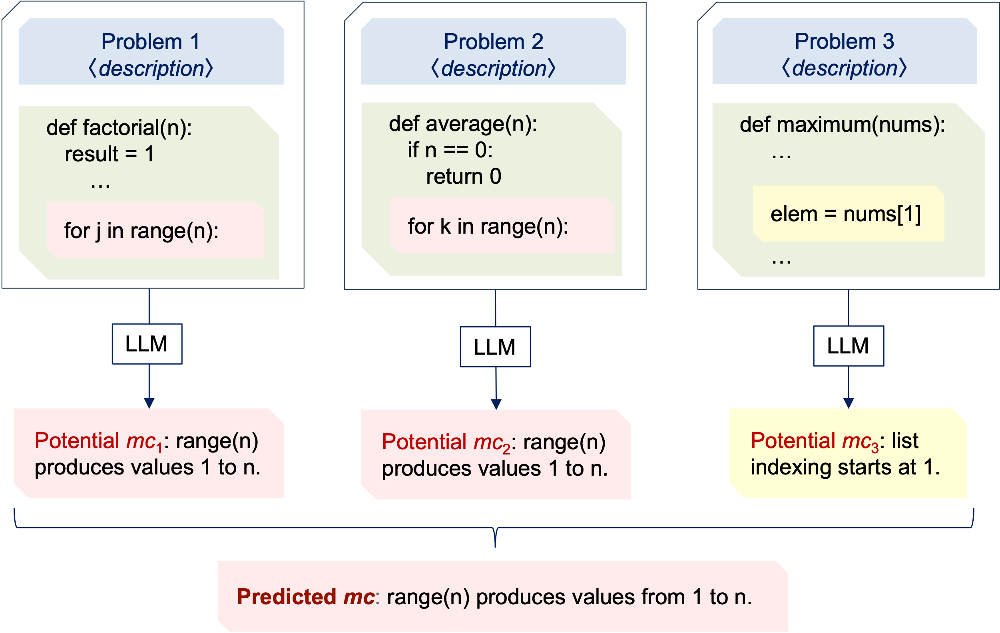

# ⚡ MisconAI: Automated Discovery & Mining of Programming Misconceptions

<div align="center">
  <!--  -->
  <br>
  <h3>High-Precision Automated Misconception Mining in Student Code using LLMs & In-Context RAG</h3>
  <p>
    <b>Author:</b> NIKHIL KUMAR SAH &nbsp;|&nbsp; 
    <b>Engines:</b> Groq LPU & Google Gemini &nbsp;|&nbsp; 
    <b>Benchmark:</b> 501 Problems & 67 Misconceptions
  </p>
</div>

---

## 📖 Table of Contents
1. [Overview & Motivation](#-overview--motivation)
2. [What is a Programming Misconception?](#-what-is-a-programming-misconception)
3. [Core Methodologies: Old (Baseline) vs. New (Enhanced)](#-core-methodologies-old-baseline-vs-new-enhanced)
4. [Architecture & In-Context Taxonomy RAG](#-architecture--in-context-taxonomy-rag)
5. [Empirical Performance Matrix & Benchmark Results](#-empirical-performance-matrix--benchmark-results)
6. [Streamlit Web Application (MisconAI Studio)](#-streamlit-web-application-misconai-studio)
7. [🤖 Python Misconception Chatbot — How It Works](#-python-misconception-chatbot--how-it-works)
8. [Datasets & Benchmark Composition](#-datasets--benchmark-composition)
9. [Project File Structure](#-project-file-structure)
10. [Installation & Setup](#-installation--setup)
11. [Running the Application & Evaluations](#-running-the-application--evaluations)
12. [License](#-license)

---

## 🌟 Overview & Motivation

When students learn computer science and Python programming, their errors are rarely random typos. Instead, they often stem from **underlying conceptual misconceptions**—false mental models about language syntax, semantics, or runtime behavior (e.g., believing `range(n)` includes `n`, assuming tuples can be modified in place, or confusing `=` with `==`).

Traditional automated grading systems (unit tests and linters) only flag *that* code failed, leaving teachers and students without insight into *why* the student wrote the code that way.

**MisconAI** is an end-to-end research framework and interactive web platform that automatically analyzes student code submissions, performs step-by-step runtime simulations, filters false positives, and maps student logic to an established taxonomy of **67 standardized Python misconceptions**.

---

## 🧠 What is a Programming Misconception?

In computer science education research, a **programming misconception** is defined as:
* A systematic, false belief held by a programmer about language semantics, built-in functions, or data structures.
* It is **concrete and reproducible** across multiple problems.
* It is **distinguished from mere syntax errors or problem misreadings** (e.g., a missing colon or an accidental typo is not a conceptual misconception).

### Canonical Examples in Python:
1. **Range Boundary Misconception:** Student believes `range(n)` produces values from `1` to `n` inclusive (rather than `0` to `n - 1`).
2. **Tuple Immutability Misconception:** Student believes tuples can be appended to in place via `test_tup.append(val)` or that `list(test_tup)` permanently mutates the tuple.
3. **Operator Equivalence Confusion:** Student uses the single equals sign `=` (assignment) inside conditional checks `if x = 0:` instead of the equality operator `==`.
4. **Boolean Precedence / Distribution:** Student writes `if x == a or b:` believing it checks if `x` is equal to `a` or equal to `b`.

---

## 🔬 Core Methodologies: Single-Instance vs Multi-Instance × Baseline vs Enhanced

MisconAI is built around two orthogonal dimensions:

**Dimension 1 — Input Strategy:**
- **Single-Instance:** One student code submission → LLM detects the misconception in that code alone
- **Multi-Instance (Bag):** A *bag* of 2–4 student code submissions for the **same problem** → LLM identifies the *common* misconception shared across the bag

**Dimension 2 — Prompting Method:**
- **Baseline (Standard Zero-Shot w/ Structured Output):** Structured prompt with clear terminology, XML output format, and `NONE` handling — but no reasoning trace and no RAG
- **Enhanced (CoT + RAG):** Adds Execution Tracing, Correctness Verification, and In-Context RAG taxonomy injection on top of the baseline

This gives **four strategies** in total:

```
┌──────────────────────────────────────────────────────────────────────┐
│  STRATEGY 1: Single-Instance Baseline (zeroshot.md / zeroshot-no-reasoning.md)   │
│                                                                                  │
│  One Student Code ─────────────────────────────────────────────────► LLM           │
│  Structured prompt with:                                                         │
│    • Misconception terminology definition                                        │
│    • Required XML output: <reasoning> <misconception> <description>              │
│    • NONE handling if no misconception found                                    │
│  Missing: No execution trace, No verification gate, No RAG                      │
│  Result: High false positive rate on clean code                                 │
└──────────────────────────────────────────────────────────────────────┘

┌──────────────────────────────────────────────────────────────────────┐
│  STRATEGY 2: Multi-Instance Baseline — Bag Method (zeroshot-multi.md)           │
│                                                                                  │
│  Bag of 2–4 Student Codes (same problem) ──────────────────────────► LLM           │
│  Structured prompt instructs LLM to:                                             │
│    • Analyse all code samples together                                          │
│    • Find the ONE common misconception shared across the bag                    │
│    • Output NONE if no common pattern found                                     │
│  Power: Multiple examples of the same misconception reinforce the signal        │
│  Same structured XML output format as Strategy 1                                │
└──────────────────────────────────────────────────────────────────────┘

┌──────────────────────────────────────────────────────────────────────┐
│  STRATEGY 3: Single-Instance Enhanced (enhanced-cot-mining.md) [OUR WORK]       │
│                                                                                  │
│  One Student Code                                                                │
│       │                                                                          │
│       ▼                                                                          │
│  [AST / Construct Feature Extractor]                                             │
│       │                                                                          │
│       ▼                                                                          │
│  [Taxonomy RAG Engine] ─── Top-K Candidates from 67-misconception bank           │
│       │                                                                          │
│       ▼                                                                          │
│  [Enhanced Structured Prompt] adds 3 gates on top of Baseline:                  │
│    1. <trace>        ← Mental step-by-step code execution before conclusion     │
│    2. <verification> ← Explicit correctness gate (forces NONE on clean code)    │
│    3. RAG candidates ← Top-K definitions injected from taxonomy bank            │
│       │                                                                          │
│       ▼                                                                          │
│  High-Precision Output: [Verified Misconception / NONE (Clean Code)]            │
└──────────────────────────────────────────────────────────────────────┘

┌──────────────────────────────────────────────────────────────────────┐
│  STRATEGY 4: Multi-Instance Enhanced — Bag + RAG [Best Performers]             │
│                                                                                  │
│  Bag of 2–4 Student Codes ─► RAG Retrieval ─► Enhanced Prompt ─► LLM            │
│  Combines the collective signal from multiple code samples (Strategy 2)         │
│  with the RAG + trace + verification pipeline (Strategy 3).                     │
│  This is the method used by o3-mini, Claude, Gemini 2.5 in the leaderboard.    │
└──────────────────────────────────────────────────────────────────────┘
```

### What “Baseline” Really Means

> **Important correction:** The Baseline is NOT naive or unstructured prompting. It uses a carefully crafted structured prompt with XML output format, precise misconception terminology, and `NONE` handling. It is called “Baseline” because it represents the **zero-shot structured prompting without reasoning steps** — the state-of-the-art before the Enhanced innovations were added.

| Feature | Baseline (Strategies 1 & 2) | Enhanced (Strategies 3 & 4) |
|---|---|---|
| Structured XML output | ✅ Yes | ✅ Yes |
| Misconception terminology | ✅ Yes | ✅ Yes |
| `NONE` if no misconception | ✅ Yes | ✅ Yes |
| `<trace>` execution step | ❌ No | ✅ Yes |
| `<verification>` gate | ❌ No | ✅ Yes |
| RAG taxonomy injection | ❌ No | ✅ Yes |
| Multi-code bag support | Strategy 2 ✅ | Strategy 4 ✅ |

### Why Single vs. Multi-Instance Matters

**Single-Instance** is harder: the LLM sees only one code sample, so weak patterns are easy to miss or hallucinate.

**Multi-Instance (Bag)** is more powerful: seeing 2–4 students all making the same type of error creates a much stronger signal that a shared underlying misconception exists. This is why top models (o3-mini, Claude) all use the Multi-Instance strategy.

### 1. Baseline Method (Standard Structured Zero-Shot)
* **Template files:** `zeroshot.md` (single), `zeroshot-multi.md` (bag), `zeroshot-no-reasoning.md` (no chain-of-thought), `zeroshot-no-reasoning-multi.md` (bag, no CoT)
* **Mechanism:** Passes student code(s) into a structured prompt with misconception terminology, XML output format, and NONE handling. The LLM reasons freely but with **no forced execution tracing, no verification gate, and no RAG candidates**.
* **The Problem:**
  - **High False Positives:** Without a verification gate, the LLM tends to flag clean code. On Groq, baseline had **93.3% false positive rate** on clean code.
  - **Terminology Drift:** Without taxonomy candidates injected, descriptions drift away from standardized misconception definitions.

### 2. Enhanced Method (CoT + Verification + RAG)
To resolve these issues, the Enhanced Methodology adds three critical innovations on top of the Baseline:
1. **Mental Execution Tracing (`<trace>`):** The LLM must mentally simulate step-by-step program execution on a concrete test case **before** drawing any conclusions.
2. **Correctness & False-Positive Verification (`<verification>`):** An explicit gate checks whether the student’s solution is actually valid or an acceptable alternative. If valid, output is forced to `NONE`.
3. **In-Context Taxonomy RAG (`utils/misconception_rag.py`):** Parses AST constructs and injects the top-K relevant definitions from the 67-misconception bank directly into the prompt.

---


## 🏗️ Architecture & In-Context Taxonomy RAG

The codebase is organized into modular components:

* **RAG Retrieval Engine (`utils/misconception_rag.py`):**
  - Analyzes Python Abstract Syntax Trees (AST) and regex patterns to identify code constructs (e.g. `ast.Subscript`, `ast.For`, `ast.Call`, `ast.Compare`).
  - Pre-indexes `dataset/misconception_bank.json` across construct categories and keywords.
  - Retrieves the top-$k$ reference candidate definitions and formats them into an in-context reference section for the LLM prompt.

* **Unified LLM Clients (`utils/llm_clients.py`):**
  - **Groq API Client:** High-speed inference using the OpenAI-compatible SDK with LPU hardware acceleration.
  - **Google Gemini Client:** Native Google GenAI integration supporting `gemini-flash-lite-latest` and reasoning models.
  - **OpenAI Client:** Full support for `o3-mini`, `o1-mini`, `gpt-4o`, and reasoning effort controls.

* **Prompt Engineering Templates (`src/prompt_templates/mining/`):**
  - `zeroshot.md`: Single-instance baseline with structured XML output and terminology.
  - `zeroshot-multi.md`: Multi-instance (bag) baseline — finds common misconception across multiple codes.
  - `zeroshot-no-reasoning.md`: Single-instance baseline without chain-of-thought (fastest, ablation study).
  - `zeroshot-no-reasoning-multi.md`: Multi-instance baseline without CoT.
  - `enhanced-cot-mining.md`: Enhanced single-instance with `<trace>`, `<verification>`, and RAG candidate injection.

---

## 📊 Empirical Performance Matrix & Benchmark Results

### 1. Baseline (Old) vs. Enhanced (New) Head-to-Head Comparison
Evaluated on **50 balanced dataset bags** (35 misconception bags + 15 correct-only bags) using the official MisconAI ground-truth evaluation methodology:

| Evaluated Engine & Model | Metric | Baseline (Old Method) | Enhanced (New Method) | Gain / Difference ($\Delta$) |
| :--- | :--- | :---: | :---: | :---: |
| **Google Gemini**<br>*(gemini-flash-lite-latest)* | **Overall Accuracy** | 46.00% | **60.00%** | <span style="color:green">**+14.00%**</span> |
| | **Precision** | 61.54% | **88.89%** | <span style="color:green">**+27.35%**</span> |
| | **Clean Code Accuracy** | 46.67% (7/15) | **93.33% (14/15)** | <span style="color:green">**+46.67%**</span> |
| | **False Positives** | 10 false alarms | **2 false alarms** | **-80.0% reduction** |
| | **F1 Score** | 54.24% | **61.54%** | <span style="color:green">**+7.30%**</span> |
| | | | | |
| **Groq LPU**<br>*(qwen/qwen3.8-27b)* | **Overall Accuracy** | 46.00% | **54.00%** | <span style="color:green">**+8.00%**</span> |
| | **Precision** | 51.16% | **71.43%** | <span style="color:green">**+20.27%**</span> |
| | **Clean Code Accuracy** | 6.67% (1/15) | **80.00% (12/15)** | <span style="color:green">**+73.33%**</span> |
| | **False Positives** | 21 false alarms | **6 false alarms** | **-71.4% reduction** |
| | **True Negatives** | 1 verified clean | **12 verified clean** | **+1100% boost** |

### 2. Full Dataset Bags Benchmark (339 Bags across 67 Misconceptions)

| Model & Provider | Strategy | Overall Accuracy | Precision | Recall | F1 Score |
| :--- | :---: | :---: | :---: | :---: |
| **OpenAI o3-mini (Medium Effort)** *(Top Proprietary)* | Multi-Instance (Bag) | **78.49%** | 83.27% | 70.83% | **76.55%** |
| **OpenAI o3-mini (Low Effort)** | Multi-Instance (Bag) | **76.98%** | 85.65% | 67.49% | **75.49%** |
| **Claude Sonnet 4.5 (Reasoning)** | Multi-Instance (Bag) | **68.68%** | 83.76% | 77.21% | **80.35%** |
| **Gemini 2.5 Flash (Paper Baseline)** | Multi-Instance (Bag) | **62.83%** | 79.79% | 56.20% | **65.95%** |
| **Google Gemini (`gemini-flash-lite`)** *(Enhanced)* | Multi-Instance (Bag) | **60.00%** | **88.89%** | 47.06% | **61.54%** |
| **Groq (`qwen/qwen3.8-27b`)** *(Enhanced)* | Multi-Instance (Bag) | **54.00%** | **71.43%** | 46.88% | **56.60%** |
| **Groq (`qwen/qwen3.8-27b`)** *(Baseline Zero-Shot)* | Multi-Instance (Bag) | **35.99%** | 40.93% | 55.75% | **47.20%** |
| **Groq (`openai/gpt-oss-120b`)** | Multi-Instance (Bag) | **18.29%** | 40.00% | 0.72% | 1.42% |

*Detailed markdown report available in [performance_matrix_analysis.md](performance_matrix_analysis.md).*

---

## 💻 Streamlit Web Application (MisconAI Studio)

The interactive web application ([src/app.py](src/app.py)) provides a modern, glassmorphic interface:

<div align="center">
  
</div>

### Features:
1. **🔬 Misconception Mining Lab (Tab 1):**
   - **Preset Selector:** One-click testing with authentic student code presets:
     - `Factorial range(n)` (Boundary misunderstanding)
     - `Tuple In-Place Mutability` (Attempting `.append()` on tuples)
     - `Conditional Assignment '=' vs '=='` (Assignment in `if` branch)
     - `Clean Recursive Factorial` (Valid code verification)
     - `Clean Matrix Transpose` (Valid code verification)
   - **Methodology Switcher:** Live sidebar toggle between **Enhanced (Trace + RAG)** and **Standard (Basic Zero-Shot)**.
   - **Visual Output Cards:** 
     - 🐛 Red/Amber diagnostic card for identified misconceptions.
     - ✅ Green confirmation card for verified clean code.
     - Interactive expanders for **Step-by-Step Execution Trace**, **Verification Check**, and **RAG Taxonomy Candidates**.

2. **🤖 Python Misconception Chatbot (Tab 2):** *(New)*
   - **75 curated Python questions** spanning 18 topics (Basics, Strings, Lists, Tuples, Sets, Dicts, Control Flow, Functions, OOP, Exceptions, Comprehensions, File I/O, Modules, Generators, Decorators, Types, Built-ins, Memory, Scope, Recursion, Operators, Advanced, Iterators, Python 3).
   - **Free-text answers** — student writes their understanding in natural language (no multiple choice).
   - **RAG-Enhanced diagnosis** using the Enhanced Methodology pipeline — retrieves related misconceptions from the 67-entry taxonomy bank and runs Chain-of-Thought analysis.
   - **Correct answers** → reinforcement explanation with a confirming code example.
   - **Wrong answers** → named misconception + friendly explanation + reasoning trace + RAG taxonomy matches.
   - Pure learning tool — no scoring, no game mechanics. Focus on understanding *why* a concept works the way it does.

3. **📈 Empirical Benchmark & Performance Matrix (Tab 3):**
   - High-contrast KPI metric cards with live gain indicators.
   - Interactive column-wise difference tables displaying Old vs New accuracy, precision, and false alarm reduction.
   - Leaderboard comparing Groq, Gemini, OpenAI o3-mini, and Claude.

4. **📚 Taxonomy Bank Explorer (Tab 4):**
   - Instant search and filtering across all **67 Python misconceptions**.
   - Search by keyword (`range`, `slicing`, `tuple`, `recursion`) or construct ID.
   - Expandable documentation cards with code examples and expected outputs.

---

## 🤖 Python Misconception Chatbot — How It Works

The **Python Misconception Chatbot** (Tab 2 of MisconAI Studio) is an interactive learning tool that diagnoses a student's conceptual misunderstandings from their **free-text answers** using the same Enhanced Methodology pipeline used for automated code mining.

### 🎯 Purpose
Unlike the Mining Lab (which analyses code), the Chatbot targets **conceptual understanding** — a student selects a Python concept question, explains their understanding in plain English, and the AI tells them precisely what they got right, what they got wrong, and *why* their mental model is incorrect.

### 🔄 End-to-End Flow

```
┌────────────────────────────────────────────────────────────────────────────┐
│                  Python Misconception Chatbot — Architecture               │
│                                                                            │
│  [Question Bank]  75 questions across 18 topics                           │
│       │                                                                    │
│       ▼                                                                    │
│  Student selects a question + types their answer in natural language       │
│       │                                                                    │
│       ▼                                                                    │
│  ┌─────────────────────────────────────────────────────┐                  │
│  │  Step 1: RAG Retrieval (misconception_rag.py)        │                  │
│  │  Query = topic + question + student_answer +         │                  │
│  │          misconception_hint                          │                  │
│  │  → Retrieves Top-K related misconceptions from      │                  │
│  │    the 67-entry misconception_bank.json              │                  │
│  └─────────────────────────────────────────────────────┘                  │
│       │                                                                    │
│       ▼                                                                    │
│  ┌─────────────────────────────────────────────────────┐                  │
│  │  Step 2: Enhanced Chain-of-Thought Prompt            │                  │
│  │  Injected context:                                   │                  │
│  │    • The question text + correct reference answer    │                  │
│  │    • The student's free-text answer                  │                  │
│  │    • RAG-retrieved taxonomy candidates               │                  │
│  │  Required output format:                             │                  │
│  │    <reasoning>                                       │                  │
│  │      <trace>  ← How the student's mental model works│                  │
│  │      <verification>  ← What Python actually does    │                  │
│  │    <misconception>                                   │                  │
│  │      <description>  ← Named misconception or NONE   │                  │
│  │      <explanation>  ← Friendly pedagogical fix      │                  │
│  └─────────────────────────────────────────────────────┘                  │
│       │                                                                    │
│       ▼                                                                    │
│  ┌─────────────────────────────────────────────────────┐                  │
│  │  Step 3: Structured Response Parsing                 │                  │
│  │  parse_mining_response() extracts XML tags →        │                  │
│  │    trace, verification, description, explanation     │                  │
│  └─────────────────────────────────────────────────────┘                  │
│       │                                                                    │
│       ▼                                                                    │
│  ✅ CORRECT  → Green banner + reinforcing explanation                      │
│  ⚠️ MISCONCEPTION → Named misconception + explanation + trace + RAG panel  │
└────────────────────────────────────────────────────────────────────────────┘
```

### 🧠 Methods Used

The chatbot reuses the **same three core innovations** as the Enhanced Methodology:

| Method | How it applies to the Chatbot |
|--------|-------------------------------|
| **RAG Retrieval** | The student's answer text + topic is used as the RAG query to fetch the most relevant misconception entries from `misconception_bank.json` and inject them into the LLM prompt. |
| **`<trace>` — Mental Model Analysis** | The LLM traces the student's reasoning: *"The student appears to believe that `b = a` copies the list because..."* — it models the incorrect mental model step by step. |
| **`<verification>` — Python Reality Check** | The LLM explicitly states what Python actually does and why, grounded in language semantics, not hallucination. |

### 📋 Question Bank Design

The 75 questions are designed to target the most common Python misconceptions in introductory programming education:

| Topic Category | Example Misconceptions Targeted |
|---|---|
| **Lists** | Reference vs. copy (`b = a`), `.append()` returns `None`, slicing exclusivity |
| **Strings** | Immutability, 0-based indexing, method return values |
| **Functions** | Mutable default arguments, implicit `None` return, `*args` vs `**kwargs` |
| **Control Flow** | `range()` exclusivity, `break` vs `continue`, `for/else` semantics |
| **OOP** | `self` is convention not keyword, `__init__` vs `__new__`, `@staticmethod` vs `@classmethod` |
| **Memory** | `is` vs `==`, shallow vs deep copy, variable referencing |
| **Types** | `bool` is subclass of `int`, dynamic typing, type hints not enforced |
| **Scope** | LEGB rule, `global` vs `nonlocal`, closures |
| **Advanced** | GIL, generators vs lists, star unpacking |

### ⚡ Diagnosis Output Structure

When a student submits a **wrong or partial answer**, the chatbot produces:

```
⚠️  Misconception Detected
    ─────────────────────────────────────────
    🧩  Misconception: [Named misconception, e.g. "Reference Copy Confusion"]

    📖  Explanation & Correction:
        [Friendly text: why the student's thinking is logical but wrong,
         what Python actually does, concrete code example, memorable tip]

    🔍  How Your Reasoning Led Here (Trace expander):
        [Step-by-step mental model the student was using]

    🛡️  What Python Actually Does (Verification expander):
        [The actual Python runtime behavior with evidence]

    📚  Related Misconceptions from Taxonomy Bank (RAG expander):
        [Top matching entries from the 67-misconception bank]

    📋  Reference Answer (always available in expander)
```

When the answer is **correct**:
```
✅  Correct Understanding
    [Reinforcement explanation confirming why the student's model is sound]
```

### 🔑 Key Design Decisions

1. **Free-text over multiple choice** — Forces the student to actually articulate their mental model, not guess. The LLM evaluates *reasoning quality*, not keyword matching.
2. **No scoring** — The chatbot is a learning tool, not an assessment. Removing scores reduces anxiety and encourages exploration.
3. **Topic filter** — Students can drill into specific topics (e.g., "I struggle with Lists") rather than being forced through sequential questions.
4. **Reference answer always available** — Transparency: students can always see the authoritative explanation after attempting their own answer.
5. **Same LLM + model selection as Mining Lab** — The sidebar provider/model toggle applies to the chatbot too, so students and researchers can compare how different models diagnose misconceptions.

---

## 📁 Datasets & Benchmark Composition

All datasets are contained in the `dataset/` directory:

1. **`dataset/problems_processed.json` (501 Programming Tasks):**
   - Curated from MBPP (438 problems), Socratic Debugging (27 problems), Auckland Logic Errors (8 problems), FalconCode (6 problems), and handcrafted educator tasks (19 problems).
   - Averaging **3.31 automated unit tests per problem**.

2. **`dataset/misconception_bank.json` (67 Standardized Misconceptions):**
   - Adapted from the Python Programming Misconception Bank (17 items), SIDELib (36 items), and educational research (14 items, including out-of-domain patterns).
   - Indexed with related constructs and canonical error examples.

3. **`dataset/corrupted_codes_best/` (1,063 Ground-Truth Code Samples):**
   - Synthetic and student code submissions paired with validated ground-truth misconception annotations.

4. **`dataset/bags_and_results/`:**
   - Multi-instance problem bags for evaluating collective misconception discovery across student submissions.

---

## 🗂️ Project File Structure

```text
miscon-ai/
├── dataset/                               # Dataset & Benchmark files
│   ├── bags_and_results/                  # Multi-instance problem bags & evaluation runs
│   │   ├── enhanced_evaluations/          # Baseline vs Enhanced comparison JSONs
│   │   ├── gemini_evaluations/            # Gemini prediction outputs & summaries
│   │   └── groq_evaluations/              # Groq model benchmark outputs
│   ├── corrupted_codes_best/              # Ground-truth student code samples
│   ├── misconception_bank.json            # 67 standardized Python misconceptions
│   └── problems_processed.json            # 501 programming problems with unit tests
├── src/                                   # Application source code
│   ├── app.py                             # Modern Streamlit Web UI (Studio)
│   └── prompt_templates/mining/           # Prompt definitions
│       ├── enhanced-cot-mining.md         # Enhanced CoT + Trace + RAG prompt template
│       └── zeroshot-no-reasoning.md       # Standard zero-shot baseline prompt
├── utils/                                 # Core engines & utilities
│   ├── llm_clients.py                     # OpenAI, Groq, and Gemini API connectors
│   └── misconception_rag.py               # AST & construct-based Taxonomy RAG indexer
├── history.txt                            # Chronological project progress & milestones
├── performance_matrix_analysis.md         # Detailed empirical evaluation reports
├── requirements.txt                       # Project dependencies
├── LICENSE                                # MIT License (NIKHIL KUMAR SAH)
└── README.md                              # Comprehensive project documentation
```

---

## 🚀 Installation & Setup

### Prerequisites
* Python 3.10, 3.11, 3.12, or 3.13
* Windows, macOS, or Linux

### 1. Clone & Setup Virtual Environment
```bash
# Clone the repository
git clone https://github.com/nikhilkumarsah/miscon-ai.git
cd miscon-ai

# Create and activate Python virtual environment
python -m venv venv

# On Windows:
venv\Scripts\activate

# On macOS/Linux:
source venv/bin/activate
```

### 2. Install Dependencies
```bash
pip install -r requirements.txt
```

### 3. Configure API Keys
Create a `.env` file in the project root:
```env
# Groq API Key (for ultra-fast LPU inference: Qwen 3.8 27B, GPT-OSS)
GROQ_API_KEY=your_groq_api_key_here

# Google Gemini API Key (for Gemini Flash Lite & Gemini 3.8)
GEMINI_API_KEY=your_gemini_api_key_here

# Optional: OpenAI API Key (for o3-mini, GPT-4o)
OPENAI_API_KEY=your_openai_api_key_here
```

---

## 💻 Running the Application & Evaluations

### 1. Launch the Streamlit Web Application
```bash
streamlit run src/app.py
```
Open your browser and navigate to **`http://localhost:8501`**.

### 2. Run the Baseline vs. Enhanced Empirical Benchmark
To reproduce the head-to-head evaluation across 50 balanced dataset bags:

* **For Groq (`qwen/qwen3.8-27b`):**
  ```bash
  python scratch/test_enhanced_methodology.py
  ```

* **For Google Gemini (`gemini-flash-lite-latest`):**
  ```bash
  python scratch/evaluate_gemini_enhanced.py
  ```

Results will automatically save to:
- `dataset/bags_and_results/enhanced_evaluations/baseline_vs_enhanced_comparison.json`
- `dataset/bags_and_results/gemini_evaluations/gemini_baseline_vs_enhanced.json`

---

## 📜 License

This project is licensed under the **MIT License** - see the [LICENSE](LICENSE) file for details.  
**Copyright (c) 2026 NIKHIL KUMAR SAH**
